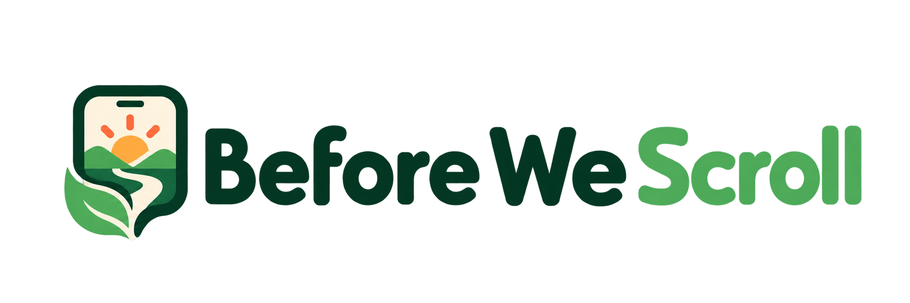
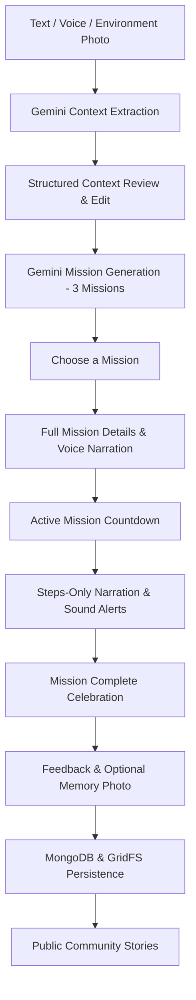

<p align="center">
  
</p>

<h1 align="center">Before We Scroll</h1>

<p align="center">
  <strong>Less scrolling. More doing.</strong>
</p>

<p align="center">
  Before We Scroll turns text, voice, and photos of your surroundings into tailored real-world missions designed to get you away from the screen and into the moment.
</p>

<p align="center">
  <a href="https://before-we-scroll.vercel.app/"><strong>Explore the Live Demo &rarr;</strong></a>
</p>

<p align="center">
  
  
  
  
  
  
  
  
</p>

---

## Quick Links

- **Live Production App:** [https://before-we-scroll.vercel.app/](https://before-we-scroll.vercel.app/)
- **GitHub Repository:** [https://github.com/sheda3838/before-we-scroll](https://github.com/sheda3838/before-we-scroll)
- **Detailed Build Log:** [BUILD_LOG.md](./BUILD_LOG.md)

---

## Project Overview

### The Problem
When people have 15 or 30 minutes of free time, they default to scrolling feeds on autopilot. Even when standing in a park, sitting on a balcony, or hanging out in a living room, the phone screen wins by default—not because physical surroundings lack interesting things to do, but because deciding what to do takes effort.

### The Solution
**Before We Scroll** acts as a catalyst between screen fatigue and real-world engagement. By taking in what you have around you—through typed intent, spoken thoughts, or a quick snapshot of your environment—it extracts a structured understanding of:
- Who you are with (solo, pair, family, group)
- Your available time budget (5 to 60+ minutes)
- Your physical environment (park, backyard, urban sidewalk, living room)
- Available features and equipment (trees, benches, ball, chalk, nothing at all)
- Safety constraints (no running, kid friendly, quiet)

It then synthesizes **exactly three tailored micro-missions**, narrates them aloud with lifelike voice synthesis, counts down the execution, and gives you a space to capture a memory before heading back to your day.

---

## Core Experience



1. **Multimodal Input:** Type, speak via ElevenLabs STT, or snap a photo of your environment.
2. **Context Understanding:** Gemini 3.1 Flash Lite extracts a structured `MissionContext`.
3. **Context Review:** Transparently verify and edit your plan, surroundings, and safety preferences.
4. **Three Missions:** Gemini generates three diverse, context-fitting activities.
5. **Listen & Choose:** Inspect steps, equipment, and duration, with optional ElevenLabs voice narration.
6. **Execution Countdown:** An interactive, refresh-safe mission timer with milestone audio cues.
7. **Complete & Reflect:** Reflect with a 5-star rating, structured feedback, and an optional memory photo.
8. **Community Stories:** Opt in to share your experience publicly in the community feed.

---

## Key Features

### 🎙️ Multimodal Context Input
- **Unified Input:** Type your thoughts, tap to speak, or upload/snap an environment photo.
- **Mix & Match:** Use any single modality or combine voice + photo or text + photo seamlessly.
- **ElevenLabs Speech-to-Text:** Client-side audio recording with server-side speech recognition.

### 🧠 AI Context Understanding
- **Structured Extraction:** Converts messy human descriptions and environment photos into normalized `MissionContext` objects.
- **Zero Raw Data Exposure:** Presents clean, categorized categories (Your Plan, Your Surroundings, What's Around You, Safety).
- **Interactive Correction:** Every extracted detail remains user-editable before generation.

### 🎯 Context-Aware Mission Generation
- **Strictly Grounded:** Only utilizes equipment explicitly listed as available—never hallucinates supplies you don't have.
- **Diverse Options:** Always generates three structurally distinct activities with different physical and creative objectives.
- **Safety Conscious:** Adheres to kid-friendly, low-mobility, or quiet constraints.

### ⏱️ Refresh-Safe Mission Timer
- **Timestamp-Based Accounting:** Timer calculates elapsed time against absolute timestamps—browser reloads, backgrounding tabs, or lock screens do not reset or desync the countdown.
- **Audio Feedback:** Synthesized audio cues alert you when time is running low and when the mission is complete.
- **Early Finish & Steps Access:** Review instructions at any moment or complete the activity early.

### 🔊 Lifelike Voice Narration (ElevenLabs)
- **Full Mission Narration:** Listen to the complete mission brief, background, and numbered steps before starting.
- **Active Mission Narration:** One-tap audio recap of just the actionable steps during execution.
- **Full Playback Controls:** Play, pause, resume, replay, and stop with status indicators.

### 📝 Reflection & Memory Photo
- **Comprehensive Feedback:** 5-star rating, context-fit accuracy, instruction clarity, and subjective difficulty.
- **Memory Photos:** Attach an optional completion photo (JPEG, PNG, WebP up to 10MB) stored securely in MongoDB GridFS.
- **Privacy Controls:** Independent opt-in toggles for sharing feedback text and sharing completion photos.

### 🌿 Community Stories
- **Real Explorer Memories:** Browsable public cards showing community completions with ratings, comments, and approved photos.
- **Zero Data Leakage:** Strips internal session identifiers, context parameters, and private notes.

### 📱 Premium Mobile-First Design
- **Tailored Aesthetics:** Forest green, warm sunrise accents, and cream background palette inspired by nature.
- **Light & Dark Mode:** Smooth theme transitions with local persistence and pre-hydration flash prevention.
- **Lucide Iconography:** Clean vector icon system across all UI elements—zero decorative emojis.
- **Accessible & Touch-Friendly:** 44px+ tap targets, semantic dialogs, and clear focus states.

---

## AI Model Architecture & Decisions

During Phase 1, we conducted controlled context-extraction benchmarks between open and hosted models using Google GenAI to evaluate structured JSON extraction performance:

- **Gemma 4 26B A4B (`gemma-4-26b-a4b-it`):** Average latency **30.35s** (median **28.77s**).
- **Gemma 4 31B (`gemma-4-31b-it`):** Average latency **71.06s** (median **71.52s**).
- **Gemini 3.1 Flash Lite (`gemini-3.1-flash-lite`):** Average latency **2.88s** (median **1.12s**) with **100% success** in the controlled benchmark.

**Decision:** Because sub-3-second response times are essential for an interactive consumer onboarding flow, Gemini 3.1 Flash Lite was selected for production context extraction and mission generation. Detailed benchmark methodology and full test logs are preserved in [BUILD_LOG.md](./BUILD_LOG.md).

---

## Tech Stack

| Layer | Technology | Purpose |
| :--- | :--- | :--- |
| **Framework** | [Next.js 16](https://nextjs.org/) (App Router, Turbopack) | Full-stack application, server routes, SSR |
| **UI Library** | [React 19](https://react.dev/) | Component architecture, state management |
| **Language** | [TypeScript](https://www.typescriptlang.org/) | Strict end-to-end type safety |
| **Styling** | [Tailwind CSS 4](https://tailwindcss.com/) | Modern CSS utility design system |
| **Icons** | [Lucide React](https://lucide.dev/) | Clean, consistent vector icon system |
| **AI — Understanding** | [Google Gemini 3.1 Flash Lite](https://ai.google.dev/) via `@google/genai` | Multimodal context extraction and structured mission planning |
| **AI — Voice STT & TTS** | [ElevenLabs](https://elevenlabs.io/) API | Speech-to-text input and natural text-to-speech narration |
| **Database** | [MongoDB](https://www.mongodb.com/) (Node.js Driver v7) | Persistent completions and feedback storage |
| **Image Storage** | MongoDB GridFS (`completionPhotos`) | Binary chunk storage for user completion photos |
| **Hosting** | [Vercel](https://vercel.com/) | Edge-optimized production deployment |

---

## System Architecture

```text
Browser Client (Mobile / Desktop)
│
├── Multimodal Inputs: Text, Audio Recording (Web Audio API), Environment Photos
│
▼
Next.js App Router (Server-Side)
│
├── POST /api/context/analyze   ──► Google Gemini 3.1 Flash Lite (Multimodal Context)
├── POST /api/mission/generate  ──► Google Gemini 3.1 Flash Lite (3 Structured Missions)
├── POST /api/transcribe        ──► ElevenLabs Speech-to-Text API
├── POST /api/tts               ──► ElevenLabs Text-to-Speech API
├── POST /api/completions       ──► MongoDB ("before-we-scroll" database)
│                                    └── GridFS Bucket ("completionPhotos")
│
└── GET  /api/public/completions ─► Public Sanitize Query (Consented records only)
     └── /api/public/completions/[id]/photo ──► GridFS Stream (Binary image)
```

---

## Data & Privacy

- **Server-Side API Security:** All Google Gemini, ElevenLabs, and MongoDB credentials exist strictly in server environments and are never exposed to the client.
- **No Required Account:** Completely anonymous usage with ephemeral, randomly generated UUID session IDs.
- **Environment Photos:** Uploaded surroundings photos are analyzed in-memory for context extraction and are **never** persisted to the database.
- **Completion Photos:** Memory photos attached during feedback are stored in MongoDB GridFS only upon form submission.
- **Dual-Consent Architecture:** Feedback comments and memory photos have separate public consent controls. Only submissions with explicit consent appear in the public feed.
- **Public Data Sanitization:** The public API rejects all internal IDs, sessionId tokens, prompt context, and private notes.

---

## Local Development Setup

### Prerequisites
- Node.js 20.x or 22.x
- npm 10+
- A running MongoDB instance (local or hosted)
- A Google GenAI API key ([Google AI Studio](https://aistudio.google.com/))
- An ElevenLabs API key ([ElevenLabs](https://elevenlabs.io/))

### 1. Clone & Install

```bash
git clone https://github.com/sheda3838/before-we-scroll.git
cd before-we-scroll
npm install
```

### 2. Configure Environment Variables

Copy the example environment configuration:

```bash
cp .env.example .env.local
```

*(On Windows PowerShell, use `Copy-Item .env.example .env.local`)*

Open `.env.local` and add your development credentials:

```env
# Google GenAI (for Gemini context extraction & mission generation)
GEMINI_API_KEY=your_google_genai_api_key

# ElevenLabs (for Speech-to-Text and Text-to-Speech)
ELEVENLABS_API_KEY=your_elevenlabs_api_key

# MongoDB Connection String
MONGODB_URI=mongodb://127.0.0.1:27017/before-we-scroll
```

### 3. Run the Development Server

```bash
npm run dev
```

Open [http://localhost:3000](http://localhost:3000) in your browser.

---

## Available Scripts

| Command | Description |
| :--- | :--- |
| `npm run dev` | Starts the Next.js development server with Turbopack |
| `npm run build` | Compiles the optimized production build |
| `npm start` | Runs the compiled production server |
| `npm run lint` | Runs ESLint checks |
| `npx tsc --noEmit` | Runs strict TypeScript type validation |

---

## Project Structure

```text
before-we-scroll/
├── app/
│   ├── api/
│   │   ├── completions/route.ts                # POST mission completion & feedback
│   │   ├── context/analyze/route.ts            # POST Gemini multimodal context extraction
│   │   ├── mission/generate/route.ts           # POST Gemini 3-mission generation
│   │   ├── public/completions/route.ts         # GET public community stories
│   │   │   └── [id]/photo/route.ts             # GET GridFS photo stream
│   │   ├── transcribe/route.ts                 # POST ElevenLabs STT
│   │   └── tts/route.ts                        # POST ElevenLabs TTS
│   ├── globals.css                             # Tailwind CSS 4 theme and design tokens
│   ├── layout.tsx                              # Root layout, metadata, and theme script
│   └── page.tsx                                # Main application state and stage controller
├── components/
│   ├── ActiveMission.tsx                       # Active countdown timer and steps modal
│   ├── CommunityStories.tsx                    # Public community cards gallery
│   ├── ConfirmModal.tsx                        # Accessible branded modal dialog
│   ├── ContextReview.tsx                       # Structured MissionContext confirmation
│   ├── FeedbackForm.tsx                        # Reflection rating, feedback, and photo form
│   ├── Footer.tsx                              # Global brand footer
│   ├── Header.tsx                              # Logo and theme toggle
│   ├── HowItWorks.tsx                          # Three-step introductory guide
│   ├── LandingHeroInput.tsx                    # Multimodal text, voice, and photo hero input
│   ├── MissionCards.tsx                        # 3-mission selection display
│   ├── MissionComplete.tsx                     # Celebration milestone screen
│   ├── MissionDetail.tsx                       # Full mission briefing and audio controls
│   ├── ThankYou.tsx                            # Completion summary and navigation back
│   └── ThemeToggle.tsx                         # Light / Dark mode toggle switch
├── lib/
│   ├── mongodb.ts                              # MongoDB client and GridFS bucket provider
│   ├── narrationBuilder.ts                     # Script formatter for ElevenLabs TTS
│   ├── soundEffects.ts                         # Web Audio API alert sound synthesizers
│   ├── timerUtils.ts                           # Timestamp-based countdown calculations
│   ├── ttsConfig.ts                            # ElevenLabs voice configuration
│   ├── validateMissionContext.ts               # Schema validation for context extraction
│   └── validateMissionPlan.ts                  # Schema validation for mission plans
├── public/
│   ├── favicon.png                             # Official brand browser tab icon
│   └── logo.png                                # Official brand vector logo
├── types/
│   ├── communityStory.ts                       # Public story DTO type
│   ├── completion.ts                           # Database document schemas
│   ├── feedback.ts                             # User feedback types
│   ├── mission.ts                              # Mission definition interfaces
│   ├── missionContext.ts                       # Structured context interfaces
│   └── missionPlan.ts                          # Mission plan interfaces
├── .env.example                                # Safe environment variable template
├── BUILD_LOG.md                                # Comprehensive engineering build journal
├── package.json                                # Project dependencies and scripts
└── README.md                                   # Project documentation
```

---

## API Routes Reference

| Method | Endpoint | Description |
| :--- | :--- | :--- |
| `POST` | `/api/context/analyze` | Receives user text and/or environment image, calls Gemini 3.1 Flash Lite, returns validated `MissionContext` |
| `POST` | `/api/mission/generate` | Receives confirmed `MissionContext`, calls Gemini 3.1 Flash Lite, returns exactly 3 distinct missions |
| `POST` | `/api/transcribe` | Receives client audio blob (`multipart/form-data`), sends to ElevenLabs STT, returns transcribed text |
| `POST` | `/api/tts` | Receives narration text script, calls ElevenLabs TTS, streams MP3 audio buffer back to client |
| `POST` | `/api/completions` | Persists completed mission, user rating, feedback, and optional memory photo to MongoDB & GridFS |
| `GET` | `/api/public/completions` | Returns up to 6 recent publicly consented community stories with ratings and comments |
| `GET` | `/api/public/completions/[id]/photo` | Streams binary completion photo directly from MongoDB GridFS bucket |

---

## Deployment

**Before We Scroll** is deployed to production on **Vercel**:

🔗 **[https://before-we-scroll.vercel.app/](https://before-we-scroll.vercel.app/)**

### Production Environment Variables
Deploying to Vercel requires configuring the following environment variables in the Vercel Project Settings:

- `GEMINI_API_KEY`
- `ELEVENLABS_API_KEY`
- `MONGODB_URI`

---

## Hacktoberfest 2026 Submission

This project was built for the **Hacktoberfest 2026 DEV Challenge** ("Touch Grass" theme), centered on using modern artificial intelligence to reduce screen addiction and guide people back into physical, real-world moments.

### Sponsor Technologies Used:
- **Google Gemini:** Multimodal environment understanding and creative mission generation via `@google/genai`.
- **ElevenLabs:** Lifelike voice narration and speech-to-text interaction.
- **MongoDB & GridFS:** Document storage and binary image persistence.
- **Vercel:** Production hosting and continuous edge deployment.

---

## Engineering Journey & Build Log

For a detailed, chronological breakdown of every engineering phase, benchmark experiment, and architectural decision, explore:

📖 **[BUILD_LOG.md](./BUILD_LOG.md)**

Highlights documented in the build log:
- Gemma 4 vs. Gemini 3.1 Flash Lite speed and quality benchmarks
- Multimodal image processing and schema validation
- Speech-to-text and text-to-speech audio pipelines
- Timestamp-based mission countdown architecture
- GridFS binary photo storage implementation
- Complete brand evolution and final UI polish

---

## Project Status

- **Core MVP:** Complete
- **Production Deployment:** Live & Verified
- **Release Validation:** 100% Passed (TypeScript, ESLint, Next.js Turbopack build)

### Potential Future Explorations
- Authenticated explorer accounts with personal mission histories
- Searchable community mission map by location type
- Collaborative multi-device group missions

---

## License

No license has been specified yet.
